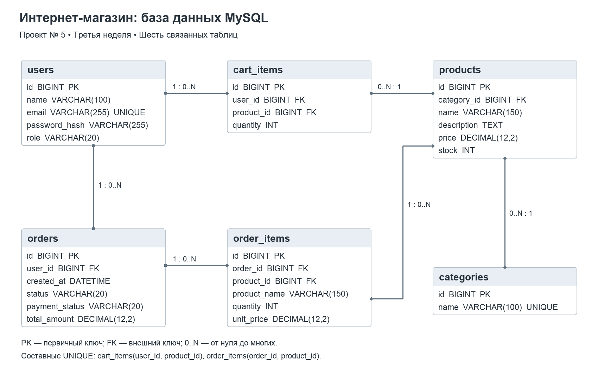

# Отчёт за третью неделю

Проект № 5. E-Commerce Platform with Order and Inventory Management.

## Что нужно было сделать

В исходном документе третья неделя называется «MySQL и CRUD». Результат этого этапа — связанные таблицы, подключение базы и основные операции с данными. Поэтому на этой неделе я занялся базой данных и backend интернет-магазина.

До этого в папке были только материалы первой недели. Для работы с базой я также добавил необходимую основу второй недели: Spring Boot-проект на Maven и разделение на Controller, Service и Repository.

## Что получилось

В MySQL создано шесть таблиц: users, categories, products, cart_items, orders и order_items. Товар связан с категорией, корзина — с пользователем и товаром, заказ — с пользователем, а позиция заказа — с заказом и товаром.

Для категорий и товаров сделаны создание, просмотр списка и отдельной записи, изменение и удаление. Данные сохраняются в MySQL. У товара есть название, описание, цена, остаток и категория.

Я добавил SQL-схему и демонстрационные данные: три категории и три товара. Для каждой таблицы есть Java-сущность и Repository. Таблицы пользователей, корзины и заказов подготовлены для следующих этапов; API для них пока нет.

## Как устроен код

Controller принимает запросы и возвращает ответ. Service проверяет данные и выполняет операцию. Repository обращается к MySQL через Spring Data JPA и Hibernate.

В model находятся сущности таблиц. В dto — данные запросов и ответов. Так в ответе о товаре можно передать номер и название категории, не отправляя все связанные объекты.

Для цены использую BigDecimal, в MySQL — DECIMAL(12, 2). Изменения выполняются в транзакциях. Hibernate при запуске проверяет готовую схему, а не пересоздаёт базу.

## Проверки и ошибки

Нельзя создать товар без названия, описания, цены, остатка или категории. Цена должна быть больше нуля и иметь не более двух знаков после десятичной точки. Остаток должен быть целым числом и не может быть отрицательным.

Нельзя создать две категории с одинаковым названием. Категорию с товарами удалить нельзя. Товар, который используется в корзине или заказе, также удалить нельзя. Эти проверки помогают сохранить связи между таблицами.

При создании сервер возвращает 201, при чтении и изменении — 200, после удаления — 204. Для неверных данных используется 400, для отсутствующей записи — 404, для конфликта данных — 409. Ошибка возвращается в JSON с понятным сообщением.

## Как проверить

Сначала нужно создать базу и выполнить schema.sql, затем один раз загрузить seed.sql. После указания параметров MySQL приложение запускается командой `mvn spring-boot:run`. Подробные команды находятся в README.md.

Для ручной проверки подготовлена коллекция Postman. Она позволяет создать категорию и товар, получить и изменить их, проверить ошибки и удалить тестовые записи. Полученные id сохраняются в переменных коллекции.

Автоматизированные тесты используют отдельную MySQL-базу ecommerce_test. Они проверяют CRUD, неверные значения, отсутствие записей и запрет удаления связанных данных. Запуск — `mvn test`. Тестовые записи откатываются после каждой проверки.

## Что осталось на следующие недели

На этом этапе ещё нет рабочего интерфейса, регистрации, входа и проверки ролей. Оформление заказа, изменение его статуса, расчёт суммы, статистика и защита от одновременной продажи последнего товара также будут добавлены позже. Сейчас приложение предназначено для локальной проверки API.

## Использование AI

При подготовке использовался ChatGPT (Codex): для создания основы проекта, SQL-схемы, CRUD, тестов и документации. Результаты технической проверки указаны ниже. Перед сдачей мне нужно самостоятельно запустить проект и разобраться в контроллерах, сервисах и связях таблиц.

## Результат проверки

Проверка выполнена на Java 21 и отдельном сервере MySQL. Команда `mvn package` завершилась успешно: 15 тестов, 0 ошибок, 0 пропусков.

Дополнительно запущен готовый JAR. Через HTTP проверены создание, чтение, изменение и удаление записей. После перезапуска приложения изменённый товар сохранился в базе. В MySQL проверены шесть таблиц и шесть внешних ключей; попытка добавить товар с несуществующей категорией отклонена.

Полный интерфейс магазина и бизнес-логика заказов ещё не проверялись, поскольку они не входят в выполненный этап.

## Схема базы данных

{width=6.3in}

Связь orders — order_items на этом этапе допускает отсутствие позиций в базе. При реализации оформления заказа сервис должен будет требовать хотя бы одну позицию.
